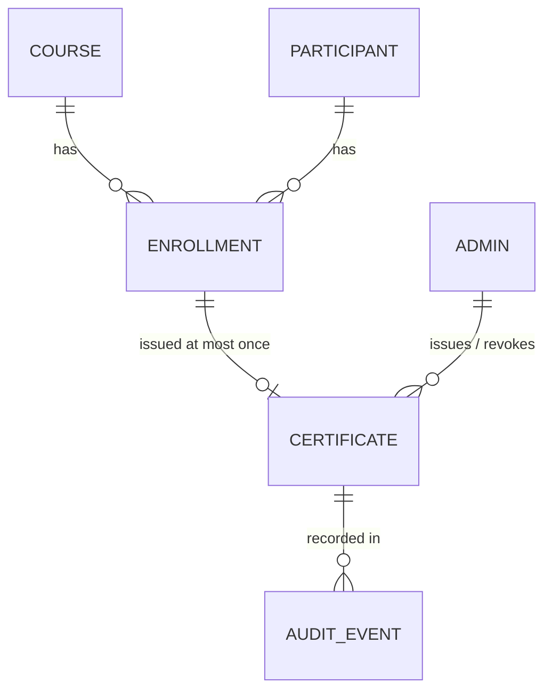

# Certificate Admin Console — Spec

Status: draft for review. Source for the plan in `docs/milestones.md`, `docs/backend_task.md` and `docs/frontend_task.md`.
Scope: `project.pdf` sections 2–5 only (product, requirements, technical constraints, rules). Decisions are logged in §9.

## 1. Product

An internal admin console for a multi-tenant corporate training platform. Tenants run training courses for their participants (the brief calls them "learners"). When a course finishes, the tenant's admin reviews it and issues completion certificates through this console.

## 2. Requirements

| #  | Requirement (brief §2–§3) | Covered by |
|----|---------------------------|------------|
| B1 | One tenant must never see another tenant's data | §5.1 |
| B2 | Each tenant has a timezone (e.g. `Australia/Sydney`, `Australia/Perth`); admins see dates in it | §4 |
| B3 | Core concepts: tenants, courses, learners, enrollments, certificates; we create the demo data | §3, §7 seed |
| B4 | Bulk issue is triggered over unreliable networks, may be retried, and must behave correctly when run more than once | §5.2 |
| B5 | Every issuance is written to an audit trail: who, when, which course, which learner | §3.2 AuditEvent, §5.2 |
| C1 | **Certificate list** for a selected tenant: search by learner name or serial; pagination; sorting; explicit loading, empty-result and error states | §5.3, §6 |
| C2 | **Bulk issue:** pick a course, issue to all eligible learners in one action. Button prevents duplicate submission and shows progress. Backend handles repeated calls. Result shows per-learner outcome (issued / skipped / failed). One audit entry per issuance | §5.2, §6 |
| C3 | **Certificate detail:** serial, course, learner, issue date in the tenant's timezone, status (valid / revoked), revoke action with confirmation | §5.4, §6 |
| C4 | **CSV export** for the selected tenant, respecting the current search/filter: learner name, course title, serial, issue date. Must stay correct as the tenant's data grows | §5.5 |

Technical constraints (brief §4–§5):

- Backend in Go, Python or Node; SQLite, MySQL or in-memory store. Frontend in Vue 3 or React.
- Starts with documented one-command steps.
- Commit to git as you go; the commit history and the AI instruction files are part of the submission.
- 3 hours in one sitting.

## 3. Domain model

### 3.1 Tenants: a registry in code, one database each

A tenant is **not** a database table. Tenants are listed in source code, keyed by a **short tenant code**, and each code maps to its own MySQL database on the same server.

```ts
// apps/api/src/tenancy/tenants.ts  (server only: it holds database names)
export const TENANTS = {
  SYD: { name: "Sydney",   timezone: "Australia/Sydney",   database: "cert_syd" },
  PER: { name: "Perth",    timezone: "Australia/Perth",    database: "cert_per" },
  ADL: { name: "Adelaide", timezone: "Australia/Adelaide", database: "cert_adl" },
} as const;
export type TenantCode = keyof typeof TENANTS;
```

```
MySQL server (one container)
  cert_syd   ← only Sydney's admin, courses, participants, enrollments, certificates, audit
  cert_per
  cert_adl
```

- The three tenants cover three different timezone behaviours: Sydney (+10/+11, daylight saving), Perth (+8, no daylight saving), Adelaide (+9:30/+10:30, half-hour offset with daylight saving).
- The short code is the tenant's one identifier everywhere: the value of the `tenant_id` header (§5.1), the key in the registry, and the serial prefix (`SYD-2026-000123`).
- Codes are 3 upper-case letters. The header value is matched exactly against the registry; anything else is rejected.
- The registry lives in the API only, because it holds database names. The web app gets code, name and timezone from `GET /api/tenants`.
- Connection details (host, user, password) come from one `DATABASE_URL_BASE` env var; the tenant's database name is appended to it.
- Setup creates, migrates and seeds every registry database that is missing (§7). Adding a tenant means adding a registry entry and re-running setup.
- Tables have **no `tenant_id` column**: which database you are connected to *is* the tenant.
- Unique keys (course code, participant email, certificate per enrollment, serial counter) are therefore per tenant automatically.
- Serials stay unique across tenants because each starts with the tenant code.

### 3.2 Tables (one Prisma schema, identical in every tenant database)



All timestamps are Prisma `DateTime` (`DATETIME(3)`), which Prisma always writes and reads as UTC. Databases use `utf8mb4` with collation `utf8mb4_0900_ai_ci`, so text comparisons ignore case and accents (`nguyen` finds `Nguyễn`).

**Admin**: `id`, `username` (unique), `name`. Exactly one row, `admin`, per tenant database. There is no login (§5.1).

**Course**: `id`, `code` (unique), `title`.

**Participant** (the brief's "learner"): `id`, `first_name`, `last_name`, `email` (unique).

**Enrollment**: `id`, `participant_id`, `course_id` (unique pair), `status` (`enrolled` | `completed`), `enrolled_at`, `completed_at`.

**SerialCounter**: `year` (primary key), `last_value`.

**Certificate**: one row is one **certificate issuance**: it exists only once a certificate has actually been issued, and it also records any later revoke. There is no batch, item or job table.

| Field | Notes |
|-------|-------|
| `id` | |
| `enrollment_id` | **unique**: at most one certificate per enrollment, i.e. per participant and course. This is the only duplicate guard needed (§5.2). Rows are never overwritten. |
| `participant_id`, `course_id` | |
| `serial` | unique, `SYD-2026-000123` (§5.2) |
| `participant_name`, `course_title` | copied at issue time; what was printed stays printed. Indexed for search and sort |
| `status` | `valid` \| `revoked` |
| `issued_at`, `issued_by` (admin id) | indexed (`issued_at`, `id`) for the default sort |
| `revoked_at`, `revoked_by`, `revoke_reason` | set on revoke |

**AuditEvent**: append-only. MySQL triggers (`BEFORE UPDATE`, `BEFORE DELETE` → `SIGNAL`) added to the Prisma migration SQL make updates and deletes fail at the database level.

| Field | Notes |
|-------|-------|
| `id`, `occurred_at` | |
| `action` | `certificate.issued`, `certificate.revoked` |
| `actor_id`, `actor_name` | who; name copied so the log reads on its own |
| `course_id`, `course_title`, `participant_id`, `participant_name`, `certificate_id`, `serial` | what |
| `details` | JSON, e.g. revoke reason |

## 4. Time rules

1. Store every instant in UTC (Prisma does this for `DateTime`).
2. Never store a fixed UTC offset per tenant. Store the IANA zone and convert per instant, so daylight saving is handled (Sydney and Adelaide change offset; Perth doesn't).
3. Anything shown to a person (list, detail, export) is in the **tenant's** timezone, never the browser's or the server's.
4. Calendar-dependent values use the tenant's local calendar: the year in a serial, and the issue date in the CSV.
5. The API returns UTC ISO-8601 instants plus the tenant's `timezone`. The server formats the CSV; the web app formats the screens. Both use `Intl.DateTimeFormat` with the IANA zone.

Tests: an issue at 2026-12-31 23:30 Perth time (15:30 UTC) shows 31 Dec 2026 in Perth and gets a `PER-2026-…` serial; Sydney and Adelaide dates on either side of a daylight-saving change render correctly.

## 5. Behaviour

### 5.1 Tenant isolation
Isolation is physical: each tenant's data is in its own database (§3.1), so a request can only ever reach one tenant's rows.

**Multitenancy stays out of the core.** The business modules (certificates, issuance, audit, export, courses, participants) never see a tenant. They are written as if there were one organisation with one database, and they never receive a context argument either. The context is **ambient**: it travels with the request's async call chain (Node `AsyncLocalStorage`), and the core reads it through one injected port that the core owns:

```ts
// apps/api/src/core/context/app-context.ts: owned by the core, no notion of "tenant"
export abstract class AppContext {
  abstract get db(): PrismaClient;       // the client to work with
  abstract get timeZone(): string;       // IANA zone for dates and the serial year
  abstract get serialPrefix(): string;   // the tenant code, e.g. "SYD"; the core only knows it as a prefix
  abstract get actor(): { id: number; name: string };
  abstract now(): Date;
}

// a core service: method signatures carry business inputs only
@Injectable()
export class CertificatesService {
  constructor(private readonly ctx: AppContext) {}

  findOne(id: number) {
    return this.ctx.db.certificate.findUnique({ where: { id } });
  }
}
```

A thin **tenancy module** (NestJS) sits around the core and is the only code that knows tenants exist:

| Piece | Job |
|-------|-----|
| Registry | tenant code → name, timezone, database (§3.1) |
| Prisma client manager | one `PrismaClient` per tenant, each pointed at that tenant's database (`datasourceUrl`) with a small connection pool; created on module init, disconnected on shutdown |
| Tenant scope store | one `AsyncLocalStorage<TenantScope>`; a `TenantScope` is a frozen `{ code, db, timeZone, actor }` |
| Tenant middleware | resolves the tenant for each request and runs the rest of the request inside its scope (below) |
| `TenantAppContext` | the tenancy module's binding for `AppContext`: each getter reads the current scope. No scope → throws (`500`); it never falls back to a tenant |
| `runInTenant(code, fn)` | runs work that doesn't come from a request (setup, seed, scripts, tests) inside a tenant's scope |

Tenant middleware, on every route except `GET /api/tenants`:
1. Read the **`tenant_id`** header (a tenant code, e.g. `SYD`). Missing, or not in the registry → `400` `{ error: "unknown_tenant" }`.
2. Take that tenant's Prisma client and timezone.
3. Load the tenant's `admin` row as the actor. Every request acts as `admin` (§8: no auth).
4. Run the rest of the request (guards, pipes, controller, core services, exception filter, streamed response) inside `store.run(scope, next)`.

Rules:
- API paths carry no tenant: `/api/certificates`, `/api/issuances`, …
- Core services are ordinary singletons that inject `AppContext` and read it **when called**. They take no context argument, read no headers, and must not import the tenancy module or `node:async_hooks`. A lint rule (`no-restricted-imports`) enforces the imports.
- Never copy an `AppContext` value into a field, a constructor or a module-level variable. Singletons outlive requests, so a cached value would carry one tenant's client or timezone into the next request.
- Transactions: inside `this.ctx.db.$transaction(async tx => …)`, work through the `tx` argument and pass it on (`AuditService.record(tx, …)`, `nextSerial(tx, …)`). `ctx.db` is the tenant's client, not the open transaction.
- The scope follows every `await`, promise, timer and stream started inside the request. The NDJSON issue run (§5.2) and the CSV export (§5.5) keep their tenant until they finish, even if the client disconnects. Work started anywhere else must go through `runInTenant`.
- Fail closed: a core call with no scope is a bug and throws. There is no default tenant.
- Core tests bind `AppContext` to a fixed object over one plain database; they need no async storage.
- A record id from another tenant returns `404`: it doesn't exist in this database.
- `GET /api/tenants` (no header needed) returns each tenant's code, name and timezone, never the database name.
- Header name note: `tenant_id` contains an underscore. Node and the Vite dev proxy pass it through, but some proxies (e.g. nginx by default) drop such headers. Fine here; worth knowing before deploying behind one.
- Test: with `tenant_id: SYD`, Perth's certificate ids return `404`; a request with no `tenant_id`, or `tenant_id: XYZ`, returns `400`; Sydney's list and export never contain Perth serials; Sydney and Perth bulk issue runs started at the same time each get only their own serials (`SYD-…` / `PER-…`), proving scopes don't leak between interleaved requests; a core service called outside any scope throws.

### 5.2 Bulk issue (safe to repeat)
Repeat safety comes from the data, not from tracking requests: the unique `enrollment_id` means a participant can hold at most one certificate per course, and an existing certificate is never overwritten. No idempotency key, job table or worker is needed.

Preview: `GET /api/issuances/preview?courseId=` → `{ completed, alreadyIssued, eligible }`, so the page can say "Issue N certificates" before the run.

Request: `POST /api/issuances` with body `{ courseId }`.

1. **Candidates** = enrollments in the course with status `completed`.
2. For each candidate, in its own short Prisma interactive transaction (`db.$transaction(async tx => …)`):
   - certificate already exists for the enrollment → **skipped** (reason: `already_issued` or `revoked`). Nothing is written, no serial is used, no audit entry.
   - otherwise take the next serial, insert the certificate, and insert its `certificate.issued` audit event; commit → **issued**.
   - unique-key clash on `enrollment_id` (Prisma error `P2002`, a concurrent run got there first) → roll back → **skipped** (`already_issued`).
   - any other error → roll back → **failed** with the message. Nothing is left behind, so the next run simply tries it again.
3. The audit entry is in the same transaction as the certificate it describes, so an audit row exists **only** for certificates this run actually committed. A retry writes audit entries only for what it newly issues.
4. **Progress:** the response is streamed as NDJSON (`Content-Type: application/x-ndjson`), one line per candidate as it is processed:
   ```
   {"type":"start","total":14}
   {"type":"result","enrollmentId":7,"participantName":"Ana O'Neil","outcome":"issued","serial":"SYD-2026-000018"}
   {"type":"result","enrollmentId":8,"participantName":"Bao Nguyễn","outcome":"skipped","reason":"already_issued"}
   {"type":"done","issued":11,"skipped":2,"failed":1}
   ```
   The web app reads the stream to drive the progress bar and fill the per-learner result table.

**Retries and repeats:**
- Network drops mid-run: everything committed so far stays. Re-running the same course issues only the rest; already-issued learners come back as skipped.
- Two tabs run the same course at once: each enrollment can only be inserted once; the other run reports it as skipped.
- The server finishes the run even if the client disconnects; each row stands on its own either way.

**Serial:** `<prefix>-<year in tenant local time>-<6-digit sequence>`, one counter per year in each tenant database, taken inside the issue transaction with one atomic statement:

```sql
INSERT INTO serial_counter (year, last_value) VALUES (?, LAST_INSERT_ID(1))
  ON DUPLICATE KEY UPDATE last_value = LAST_INSERT_ID(last_value + 1);
SELECT LAST_INSERT_ID();
```

The row lock is held until the transaction ends, so two issues cannot take the same number, and a rolled-back issue gives its number back. Serials are never reused after a commit, even after a revoke.

### 5.3 Certificate list
`GET /api/certificates?q=&status=&courseId=&sort=&order=&page=&pageSize=`

- `q`: partial match on participant name, or prefix match on serial. Case- and accent-insensitive through the database collation (§3.2).
- `status` (`valid` | `revoked`), `courseId`: optional filters.
- `sort`: `issued_at` (default, newest first) | `participant_name` | `serial` | `course_title`; `order`: `asc` | `desc`. Anything else returns `400`. The id is always added as a tie-breaker so pages are stable.
- `page` from 1, `pageSize` default 20, max 100. Response `{ items, page, pageSize, total, timezone }`.

### 5.4 Revoke
`POST /api/certificates/:id/revoke` with `{ reason }` (optional).
- `valid` → `revoked`, sets `revoked_*`, writes a `certificate.revoked` audit event in the same transaction.
- Already revoked → `200` with the current state. Repeating it is harmless and writes no second audit event.
- A revoked certificate is not re-issued by bulk issue (skipped, reason `revoked`). Re-issue is out of scope.

`GET /api/certificates/:id` returns the certificate. Its audit events come from `GET /api/audit-events?certificateId=` (§5.7).

### 5.5 CSV export
`GET /api/certificates/export.csv` takes the **same** `q`, `status`, `courseId`, `sort`, `order` as the list, and builds its Prisma `where` / `orderBy` with the same function, so the export always matches the screen. No paging: every match is exported.

- Columns: `learner_name, course_title, serial_number, issue_date` (+ `status`).
- `issue_date` is the tenant-local date `YYYY-MM-DD`.
- **Stays correct as data grows:** Prisma has no row streaming, so the export reads in batches of 1,000 using keyset pagination (Prisma `cursor` on `id` + `skip: 1`, same `orderBy`, id as tie-breaker) and writes each batch to the response stream before reading the next. Memory stays flat, and there is no `OFFSET` that slows down or skips rows as the table grows.
- RFC 4180 quoting; cells starting with `= + - @` are prefixed with `'` so spreadsheets don't run them as formulas; UTF-8 with BOM so Excel shows names like `Nguyễn` correctly.
- Filename: `certificates-<tenant code>-<local date>.csv`.
- Test: export row count equals list `total` for the same filters; an export with a batch size of 2 returns the same rows as one with 1,000.

### 5.6 Auxiliary endpoints: courses and participants
Plain create and list endpoints so demo data isn't limited to the seed. Same `tenant_id` header as everything else (§5.1), so a new record lands in the selected tenant's database only. Not part of the brief's core requirements and not audited (the audit trail covers issuance and revoke).

| Method | Path | Body | Result |
|--------|------|------|--------|
| GET  | `/api/courses` | — | all courses, by title. Also feeds the bulk issue and filter pickers |
| POST | `/api/courses` | `{ code, title }` | `201` with the course |
| POST | `/api/participants` | `{ firstName, lastName, email }` | `201` with the participant |

Validation (zod schemas in `packages/shared`, checked on both sides; a small `ZodValidationPipe` on the API):
- `code`: trimmed, upper-cased, 2–20 of `A–Z 0–9 -`; `title`: 1–200 chars after trimming.
- `firstName`, `lastName`: 1–100 chars after trimming; accents and apostrophes allowed.
- `email`: valid format, trimmed and lower-cased before saving, so `Ana@X.com` and `ana@x.com` are the same person.
- Bad input → `400` with per-field messages. Duplicate course `code` or participant `email` in this tenant → `409` naming the field. The unique keys decide (Prisma `P2002`), not a check-then-insert.

### 5.7 Audit events
`GET /api/audit-events?certificateId=&courseId=&action=&page=&pageSize=`: read-only, newest first, paginated like the list. Feeds the certificate detail's audit trail and the audit log page. Each event carries its copied actor, course, participant and serial (§3.2), so no joins are needed to display it.

## 6. Web app

| Route | Page |
|-------|------|
| `/` | Pick a tenant; remembers the last one |
| `/certificates` | List: search box (debounced), status/course filters, sortable columns, pagination, "Export CSV" (current filters), "Bulk issue" button |
| `/certificates/:id` | Detail: serial, course, learner, issue date in tenant time, status badge, audit trail, "Revoke" with a confirm dialog |
| `/audit` | Audit log: issuance and revoke events, filter by course and action, paging; rows link to the certificate |
| `/bulk-issue` | Pick a course → shows eligible count → "Issue N certificates" → progress bar → per-learner result table (issued / skipped / failed) |

- Header always shows the current tenant and its timezone, with a switcher. The user is always shown as `admin`.
- List state (search, filters, sort, page) lives in the URL search params, so reload, back button and shared links work.
- Every data view has explicit **loading**, **empty** and **error** states:
  - two empty states: "no certificates yet" vs "no results for this search", with a clear-search action;
  - error: message and a retry button.
- Server state through TanStack Query. Keep the previous page on screen while the next one loads (`placeholderData: keepPreviousData`).
- Bulk issue button: disabled and showing progress from the click until the stream ends, so a double click sends nothing new. If it is sent twice anyway, the second run only reports skips (§5.2).
- The selected tenant lives in app-shell state (remembered in `localStorage`), not in the URL. The API client adds the `tenant_id` header to every call.
- The tenant code is part of every query key, and switching tenant also clears the cache, so data from the previous tenant can never show.
- CSV export: a plain download link can't send headers, so the web app fetches the file with the header and saves the result. That holds the file in browser memory while downloading, which is fine at this size (≈ 10 MB for 100k rows); the server side still streams.

## 7. Components and stack

| Layer | Choice |
|-------|--------|
| Language | TypeScript everywhere |
| Backend | NestJS on Node 24 |
| ORM | Prisma (one schema, one migration history, applied to every tenant database) |
| Database | MySQL 8.4 in Docker Compose; one database per tenant (§3.1) |
| Frontend | React + Vite + TanStack Query + React Router |
| Shared | `packages/shared`: zod schemas and API types, used by both sides (no tenant registry; that is server-only) |
| Tests | API: Jest + Supertest (Nest defaults) against throwaway test databases on the same MySQL. Web: Vitest + Testing Library |
| Repo | npm workspaces: `apps/api`, `apps/web`, `packages/shared` |
| Start | `npm install && npm run dev` (Docker must be running): starts MySQL with `docker compose up -d --wait`, runs setup, then starts API and web together |

**Setup script** (`npm run db:setup`, also run by `dev`): for each registry tenant, `CREATE DATABASE IF NOT EXISTS`, then `prisma migrate deploy` with that tenant's URL, then seed if its `admin` table is empty. Safe to run any number of times.

Backend components:
- *Tenancy module:* registry, Prisma client manager, tenant scope store (`AsyncLocalStorage`), tenant middleware, `TenantAppContext` binding, `runInTenant`, setup script (create, migrate, seed every tenant database).
- *Core modules (tenant-unaware):* `AppContext` port, error format and validation pipe, time helpers (take a `timeZone`), serial generator, certificates (list, detail, revoke), issuance (per-learner transaction, NDJSON stream), audit, CSV export, courses, participants.

Frontend components: app shell and tenant switcher, API client (adds the tenant header; reads NDJSON and CSV responses), tenant date formatting, certificate list, certificate detail and revoke dialog, bulk issue page, shared table/pagination/state components.

**Seed (per tenant database):**
- 1 admin: `admin`.
- 3 courses.
- 10–20 participants (a different count per tenant), including names with apostrophes and accents (`O'Neil`, `Nguyễn`).
- Enrollments: most participants in 1–3 courses; a mix of `enrolled` and `completed`, so every course has learners eligible for bulk issue.
- A few certificates already issued (with matching audit events), one of them revoked, so the list, detail and "skipped" paths have something to show.
- Issue times chosen to exercise §4: one at 23:30 local on 31 Dec in Perth, one each side of a daylight-saving change in Sydney and Adelaide.

## 8. Out of scope

- Authentication. Every request acts as the tenant's single `admin` user.
- Re-issuing a revoked certificate; PDF certificates; emailing learners.
- Managing tenants, courses, participants or enrollments in the UI. Tenants come from the code registry; courses and participants can be added through the API (§5.6); enrollments come from the seed.
- Editing or deleting courses and participants.
- Cross-tenant queries or reports (no shared database to run them on, by design).
- Large-volume demo data. Export and list are built to scale (§5.3, §5.5), but the seed stays small.
- CSV import (replaced by export, D2).

## 9. Decision log

| ID  | Decision | Why | Replaces |
|-----|----------|-----|----------|
| D1  | Scope comes from `project.pdf` §2–§5 only | User instruction | — |
| D2  | CSV **export** (with current search/filter), not import | Brief §3.4 asks for export | Earlier "CSV import" |
| D3  | Learner is called **Participant** in code and UI copy; CSV header says `learner_name` as the brief does | User's naming; brief's column name | — |
| D4  | Certificates have status `valid`/`revoked`; revoke is in scope, idempotent and audited | Brief §3.3 | Earlier "revoke out of scope" |
| D5  | Bulk issue issues to **all** eligible learners of a course; no per-learner selection | Brief §3.2 "in one action" | Earlier preview with checkboxes |
| D6  | ~~Bulk issue is idempotent through an `Idempotency-Key` header plus a unique certificate per enrollment~~ superseded by D28 | Brief §2 and §3.2: retried calls must behave correctly | — |
| D7  | ~~Bulk issue runs in the background; the UI polls for progress and per-learner results~~ superseded by D30 | Brief §3.2 requires progress and issued/skipped/failed per learner; a fast `202` also avoids network timeouts | Earlier single synchronous transaction |
| D8  | Each learner's issue is its own transaction, so one failure doesn't block the rest | Brief §3.2 "failed" outcome per learner | Earlier all-or-nothing |
| D9  | ~~Admins belong to one tenant; the tenant is derived from the admin, never from the URL~~ superseded by D19 | Brief §2: admins are tenant admins; strongest isolation | Earlier "any operator, any tenant" |
| D10 | ~~No real login: `X-Admin-Id` header, picked in the UI~~ superseded by D34 | Out of the brief's scope; enough to fill the audit trail | — |
| D11 | ~~SQLite via `node:sqlite`, Node + Fastify, React + Vite, TypeScript~~ superseded by D32 | Brief §4 allowed stacks; no database server keeps start-up to one command | Earlier Postgres + Docker |
| D12 | Store IANA timezone per tenant, never a fixed offset; format all displayed dates in tenant time | Brief §2 timezones; DST | — |
| D13 | Serial `PREFIX-<tenant-local year>-<6 digits>`, never reused | Unique, readable, sortable | — |
| D14 | Participant name and course title copied onto the certificate and audit event at issue time | A certificate and its audit entry must not change if source records change | — |
| D15 | ~~CSV export streams from a cursor and reuses the list's query builder~~ superseded by D36 | Brief §3.4: stay correct as data grows and match the current filter | — |
| D16 | Out-of-tenant ids return `404` | Doesn't reveal other tenants' records; with D18 they don't exist in the tenant's database anyway | — |
| D17 | Git: merge commits for task and milestone PRs, no squash | Brief §5: commit history is part of the submission | Earlier squash for task PRs (AGENTS.md) |
| D18 | ~~One SQLite database per tenant (location set in the registry, e.g. `data/syd.db`)~~ storage engine superseded by D33; no tenant table and no `tenant_id` columns still holds | User: data separation at the database level per tenant. Isolation can't be broken by a missing `WHERE` | Earlier shared database with `tenant_id` on every table |
| D19 | ~~Tenant comes from the URL (`/api/tenants/:tenant/...`) and picks the database; the `X-Admin-Id` must exist in that tenant's `admin` table, else `401`~~ superseded by D24 | With one database per tenant, the URL slug picks the connection and the admin check confirms the caller belongs there | D9 |
| D20 | ~~Tenant registry (slug, name, IANA timezone, serial prefix) lives in source code in `packages/shared`, shared by API and web~~ superseded by D27 | User: store tenant–locale mapping as source code for this exercise | Earlier `tenant` table |
| D21 | ~~No `IssuanceBatch` / `IssuanceItem` tables. A certificate row is one **certificate issuance** with status `pending` / `valid` / `failed` / `revoked`; a bulk issue run is the rows sharing an `issuance_key`~~ partly superseded by D29 (no batch tables still holds) | User: track it on the certificate itself. Fewer tables; `pending` rows double as the worker's queue | §5.2 batch and item tables |
| D22 | ~~A `failed` issuance is retried by the next bulk issue run for that course~~ superseded by D29 (failures leave no row, so the next run retries them naturally) | Unique `enrollment_id` would otherwise block it forever | — |
| D23 | ~~Skipped learners are computed when a run's result is read, not stored~~ superseded by D30 (reported live in the stream) | Follows from D21; accepted limit in §5.2 | — |
| D24 | Tenant is selected by the **`tenant_id` request header**; it picks the database. Missing/unknown tenant → `400`. API paths carry no tenant. (The `X-Admin-Id` part is superseded by D34) | User instruction | D19 |
| D25 | Multitenancy is kept out of the core: ~~core modules receive a `RequestContext` (db, timeZone, serialPrefix, actor, clock)~~ mechanism superseded by D46; core modules never import the registry or read headers, a thin tenancy layer builds the context, and a lint import rule enforces it, all still hold | User: keep multitenancy out of the core business model. Core stays testable with one plain database | — |
| D26 | Web app keeps the selected tenant in app state, not the URL; CSV export is fetched with headers and saved from memory | Follows from D24: headers can't ride on a plain link | Earlier `/t/:tenant/...` routes |
| D27 | Tenant registry in source code, keyed by a 3-letter **tenant code** that maps to name, IANA timezone and that tenant's database. The code is the `tenant_id` header value and the serial prefix. The registry is server-only; the web app reads tenants from `GET /api/tenants`. (Tenant list itself updated by D35) | User: short tenant code maps to a specific database. Database locations stay off the client | D20 |
| D28 | No request-level idempotency (no `Idempotency-Key`). Repeat safety comes from the unique certificate per enrollment (participant + course); existing rows are never overwritten, so a retry can only add what is missing | User: uniqueness in the data guarantees no overriding operations | D6 |
| D29 | A certificate row exists only once issued (`valid` / `revoked`). No `pending` / `failed` rows, no issuance key, no worker. The `certificate.issued` audit event is written in the same transaction as the certificate, so retries audit only rows they actually committed | User: audit only records committed issuances | D21 statuses, D22 |
| D30 | Bulk issue is one synchronous request processing each learner in its own transaction, streaming NDJSON progress lines (`start` / `result` / `done`) | Brief §3.2 still needs progress and per-learner outcomes; streaming gives both without a job table | D7, D23 |
| D31 | Auxiliary API endpoints: `GET`/`POST /api/courses` and `POST /api/participants`, tenant-scoped like the rest, validated with shared zod schemas, `409` on duplicate code/email. No UI, no audit | User request | — |
| D32 | Stack: TypeScript; **NestJS** API; **Prisma** ORM; **MySQL 8.4**; **React + Vite + TanStack Query + React Router** web; npm workspaces | User choice (user wrote "NestJS + react" for the backend; read as NestJS + TypeScript) | D11 |
| D33 | One **MySQL database per tenant** (`cert_syd`, `cert_per`, `cert_adl`) on one server; one `PrismaClient` per tenant; one Prisma migration history applied to each | Follows from D18 + D32 | D18 storage engine |
| D34 | No authentication: each tenant database has one `admin` user, and every request acts as it. No admin header | User: always use admin, skip auth | D10, D24 admin part |
| D35 | Seed standard: 3 tenants — Sydney `SYD` (DST), Perth `PER` (no DST), Adelaide `ADL` (half-hour + DST); 1 admin; 3 courses; 10–20 participants per tenant | User seeding standard; three distinct timezone behaviours | Earlier 4 tenants and a 5,000-certificate tenant |
| D36 | CSV export reads in keyset-paginated batches of 1,000 (Prisma `cursor`) and streams each batch to the response; same `where`/`orderBy` builder as the list | Prisma has no row streaming; keyset batches keep memory flat and stay correct as data grows | D15 |
| D37 | Serial numbers come from a per-year counter row updated with `INSERT … ON DUPLICATE KEY UPDATE last_value = LAST_INSERT_ID(last_value + 1)` inside the issue transaction | Atomic in MySQL, row lock held to commit, rolled-back issues give the number back | — |
| D38 | Audit table is append-only at the database level: `BEFORE UPDATE` / `BEFORE DELETE` triggers that `SIGNAL` an error, added to the Prisma migration SQL | Enforces "never changed" without separate database users | Earlier "no UPDATE/DELETE grant" idea |
| D39 | One-command start: `npm install && npm run dev` starts MySQL in Docker, creates/migrates/seeds every tenant database, then runs API and web | Brief §4 one-command start | Earlier SQLite-only start |
| D40 | Text search relies on MySQL collation `utf8mb4_0900_ai_ci` (case- and accent-insensitive) | Prisma's `mode: "insensitive"` isn't available on MySQL; the collation gives the same result and more | — |
| D41 | `GET /api/issuances/preview?courseId=` returns completed / already issued / eligible counts | Bulk issue page shows the count before the run (§6) | — |
| D42 | `GET /api/audit-events` (filter by certificate, course, action; paginated) plus an `/audit` page; certificate detail reads its trail from it | M2 plan: FE fetches audit logs for issuances | Audit events embedded in the detail response |
| D43 | M1–M2 run single-tenant: `AppContext` is bound to a fixed provider (one database, timezone and prefix from env). M3 rebinds it to the tenancy module's `TenantAppContext` without changing core modules (wording updated for D46) | User milestone order puts multi-tenancy in M3; D25 makes the swap possible | — |
| D44 | Pin Prisma 6.x (per-client `datasourceUrl`) | Prisma 7 needs a driver adapter per client; 6 keeps the per-tenant clients simple | — |
| D45 | Tasks split into `docs/backend_task.md` (BE, INFRA, TEST, DOCS) and `docs/frontend_task.md` (FE); `docs/milestones.md` is the overview. Task IDs are unique across both | User request | Single ledger in `docs/milestones.md` |
